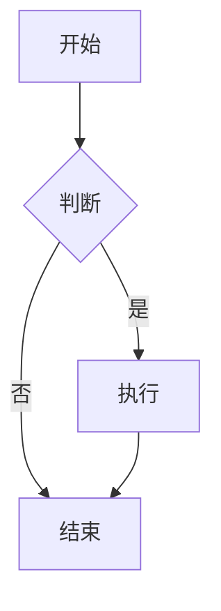
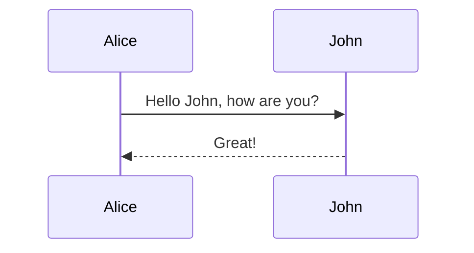

# Mermaid 图表

WeMD 内置 Mermaid 11，可以直接在编辑器里用文本绘制流程图、时序图、甘特图等常用图表。

## 快速插入

可以通过以下两种方式插入图表：

1. **工具栏按钮**：点击工具栏的「插入图表」按钮，从菜单里选一种类型，会插入对应模板。
2. **Markdown 语法**：手动写 Mermaid 代码块，语言标记要写成小写的 `mermaid`。

> 点击工具栏的「插入图表」按钮后，菜单下方的「查看更多」里是状态图、ER 图、时间线、用户旅程。

## 支持的图表类型

工具栏共提供 10 种预设模板，分在主菜单和「查看更多」两处。

### 主菜单（6 种）

- 流程图
- 时序图
- 类图
- 甘特图
- 思维导图
- 饼图

### 查看更多（4 种）

- 状态图
- ER 图
- 时间线
- 用户旅程

下面给出流程图和时序图两个示例，其余类型的代码可以在工具栏插入模板后查看。

### 流程图

### 时序图

### 预设之外的图表

工具栏只提供上面 10 种预设模板。渲染时没有图表类型的白名单，Mermaid 原生支持、但工具栏没有预设的类型，直接写成 `mermaid` 代码块也可以尝试渲染，WeMD 没有为它们准备模板和示例。

不熟悉 Mermaid 语法可参考：

- [Mermaid 官方文档](https://mermaid.js.org/intro/)
- [Mermaid 在线练习](https://mermaid.live/)

## 配色与主题

图表配色跟随当前文章主题：

- 通过主题设计器可视化编辑的主题，可以单独选择 Mermaid 的基准主题：基础、默认、森林、中性、深色。主题的主色和字体会一起作用到图表上。
- 没有经过主题设计器的主题，使用 Mermaid 的 base 基准主题。
- 在代码块开头自己写 `%%{init: ...}%%` 时，WeMD 不再注入主题配置，图表配色完全由这段配置决定。

## 复制到公众号会怎样

- 预览里是 SVG，缩放窗口时保持清晰。
- 点「复制到公众号」时，图表会按 3 倍分辨率画成 PNG 再贴入，图片宽度占满正文。
- 导出 PNG 前会先铺一层白色底，避免深色模式或公众号编辑器里透明背景导致文字看不清。
- 某张图渲染失败时，这一块退回为内联 SVG。
- 代码本身有语法错误时，这一块保持源码原样，不会变成图片。
- 「复制 HTML」只复制 HTML，不做图片转换，Mermaid 会以源码块的形式留在 HTML 里。
- 转换成图片后是静态的，Mermaid 里的点击、跳转等交互不会保留。

## 常见问题

### 为什么复制到公众号后变成了图片？

微信公众号的文章里不支持执行 JavaScript，也不支持复杂的 SVG 渲染。为了减少图表在不同设备（iOS/Android/PC）上的显示差异，WeMD 会在复制这一步把 Mermaid 图表转成 PNG。

### 为什么复制到公众号后图表背景是白色的？

复制时 WeMD 会主动给导出的 PNG 铺一层白底，避免深色模式或公众号编辑器里透明背景看不清文字。预览里的图表背景跟随主题。

### 文字显示不全怎么办？

WeMD 针对中文做了两处处理：节点内边距设为 20px，复制截图时关闭 HTML label（不用 `foreignObject`），文本按 SVG 文本绘制。如果仍然遇到显示问题，可以尝试调整浏览器缩放，或换一种字体。
