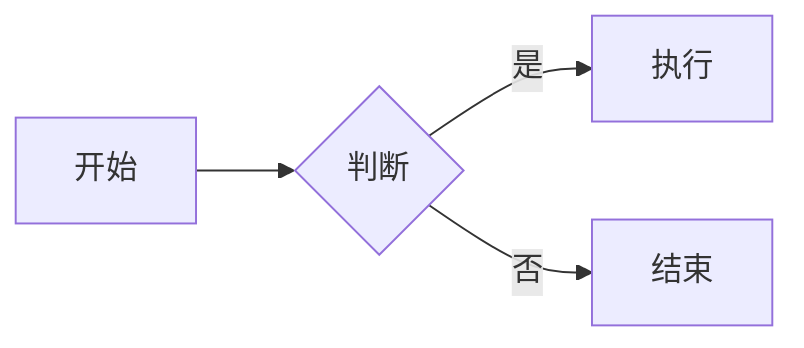

# Markdown 语法参考

本页列出 WeMD 常用的标准 Markdown 语法和 WeMD 扩展语法。本页没有列出的标准 Markdown 写法由 markdown-it 按标准规则解析。

快捷键统一见 [快捷键列表](/reference/hotkeys)，本页不再重复。

## 基础语法

| 语法 | 效果 |
| :--- | :--- |
| `# 一级标题` 至 `###### 六级标题` | 一至六级标题 |
| `**粗体**` | **粗体** |
| `*斜体*` | *斜体* |
| `~~删除线~~` | ~~删除线~~ |
| `` `行内代码` `` | `行内代码` |
| `[链接](url)` | 链接 |
| `` | 图片 |
| `> 引用` | 引用块 |
| `- 列表` | 无序列表 |
| `1. 列表` | 有序列表 |
| `---` | 分割线 |

工具栏和快捷键提供一至四级标题，五级、六级标题直接手写 `#####`、`######` 即可。

### 图片与图注

单独成段的图片会显示图注，图注文字就是 `![]` 方括号里的说明：

```markdown

```

不需要图注时把方括号留空，写成 ``。图片和文字写在同一段里时不生成图注。给图片加的局部属性作用在图片本身，不作用在图注外层。

### 嵌套引用

```markdown
> 第一层引用
> > 第二层引用
```

嵌套引用会按层级套用主题里的多级引用样式，没有为多级引用单独设计样式的主题显示为普通引用。

### 表格

```markdown
| 左对齐 | 居中 | 右对齐 |
| :--- | :---: | ---: |
| 内容 | 内容 | 内容 |
```

第一行是表头，第二行的 `| --- |` 是分隔行，冒号的位置决定该列的对齐方式。给整张表格加样式的写法见下文「局部属性与自定义样式」。

### 代码块

````markdown
```js
console.log("Hello WeMD");
```
````

在三个反引号后写语言标记即可按该语言高亮。常用的 `js`、`ts`、`python`、`java`、`go`、`rust`、`sql`、`json`、`css`、`bash`、`shell` 等都支持。没有写语言标记时按 `bash` 高亮；写了不支持的语言时按纯文本显示，不做高亮。

## 扩展语法

### 文本样式

| 语法 | 效果 | 说明 |
| :--- | :--- | :--- |
| `++下划线++` | <u>下划线</u> | 下划线 |
| `==高亮==` | 高亮文本 | 荧光笔效果 |
| `H~2~O` | H₂O | 下标 |
| `X^2^` | X² | 上标 |

### 局部属性与自定义样式

可以在段落、标题、表格、图片、链接或已有行内格式后添加 `{.class #id data-*=value}`，再通过自定义主题 CSS 精确设置该元素的样式。

```markdown
## 本章摘要 {.chapter-title #chapter-summary}

这是一段需要单独排版的摘要。 {.summary data-kind=abstract}

| 指标 | 数值 |
| --- | --- |
| 阅读量 | 1200 |

{.compact-table #metrics}

{.hero-image #cover}

[查看详情](https://example.com){.cta-link}

这是 **重点内容**{.inline-highlight}。
```

对应的自定义 CSS：

```css
#wemd .summary {
  padding: 12px 16px;
  background: #fff7e6;
}

#wemd .compact-table {
  font-size: 13px;
}

#wemd .hero-image {
  border-radius: 12px;
}

#wemd .cta-link {
  color: #1677ff;
}

#wemd .inline-highlight {
  background: #fff1b8;
}
```

行内属性支持链接、图片，以及斜体、粗体、删除线、行内代码、高亮、下划线、上标、下标等已有格式。纯文本不会自动包裹 `<span>`；需要局部样式时，应先使用一种行内格式。带 title 的链接会转换为脚注（见下文「脚注」），不再生成 `<a>`，此时紧随其后的属性文本会按原文保留。

属性仅允许 `class`、`id` 与 `data-*`。`style`、`onclick`、`src`、`href` 等其他属性不会写入或覆盖 Markdown 自身生成的地址；`id="wemd"`、`data-tool` 与 `data-wemd-*` 是系统保留项。列表项自身、代码围栏、分隔线、软换行之后和表格单元格内不支持属性写法，属性文本会按原文显示；列表项里的行内格式仍可加属性，例如 `- 要点 **重点**{.key}`。需要原样显示以 `{` 开头的属性写法时，可以写成 `\{.class}`。

### 脚注

WeMD 的脚注有两种来源：

1. **带 title 的链接**：写成 `[文字](链接 "说明")` 时，正文只显示文字和角标，文末脚注显示「说明: 链接」。这是语法层面的转换，所有带 title 的链接都会这样处理，不区分站内站外。
2. **工具栏「外链转脚注」开关**：默认关闭。开启后，普通链接也会转成正文角标加文末脚注；`mp.weixin.qq.com` 的公众号文章链接和 `#` 开头的页内锚点保持为链接。

不支持标准的 `[^1]` 脚注定义写法，脚注只来自上面两种方式。

### 任务列表

```markdown
- [ ] 未完成任务
- [x] 已完成任务
```

复选框会显示为 ✅ 和 ⬜ 文本，复制到公众号后也是如此，不能点击切换。

### 数学公式

```markdown
行内公式：$E = mc^2$

公式块：
$$
\sum_{i=1}^{n} x_i = x_1 + x_2 + ... + x_n
$$
```

写法与限制：

- 行内公式的 `$` 内侧不能有空格：`$a$` 会识别为公式，`$ a$` 和 `$a $` 都不会。
- 结束的 `$` 后面不能紧跟数字，`$a$5` 不会识别为公式；需要时在中间加空格。
- `\color`、`\textcolor`、`\colorbox`、`\fcolorbox` 等颜色命令由内置的 MathJax 渲染。
- `\bm`（粗体符号）、`\sout`（删除线）可以直接使用。
- `\ce{}`、`\SI{}` 这类没有内置的命令不会渲染，公式保留为源码显示；复制到公众号时会提示「N 个公式已降级为源码」。

### GitHub 提示块

```markdown
> [!NOTE]
> 背景信息或补充说明

> [!TIP]
> 有用的小技巧

> [!IMPORTANT]
> 重要提示

> [!WARNING]
> 需要注意的问题

> [!CAUTION]
> 高风险操作警告
```

五种提示块的默认标题依次是「备注」「提示」「重要」「警告」「危险」。在类型标记后面接文字可以自定义标题：

```markdown
> [!TIP] 写作小技巧
> 先列提纲，再填内容。
```

英文类型标记只用来选择样式，不会显示在文章里。

### 水平滑动图组

适用于在微信公众号中展示可左右滑动的多图：

```markdown
<,,>
```

触发条件：

- 整组图片写在同一行，行首是 `<`，结尾是 `>`。
- 图片之间用英文逗号分隔。
- 最多 10 张，超过 10 张不会转成图组，按普通内容显示。

图组下方会固定显示「<<< 左右滑动见更多 >>>」提示文字。

### 目录

单独一行写 `[toc]`，会在该位置生成文章目录：

```markdown
[toc]
```

目录只收录二级、三级标题。目录项没有跳转链接，点击不会定位到对应标题，只用于展示文章结构。

### 定义列表

```markdown
术语
: 对这个术语的解释
```

术语单独一行，下一行以 `: ` 开头写解释。

### 注音（冷门）

```markdown
{汉字|hàn zì}
```

会生成 HTML 的 `<ruby>` 注音标签，把竖线后的文字标在前面文字的上方。内置主题没有为注音单独设计样式，使用前建议先在预览里确认效果。

### Mermaid 图表

支持流程图、时序图、甘特图等，代码块的语言标记写成小写的 `mermaid`：

````markdown

````

详见 [Mermaid 图表指南](/guides/mermaid)。

### 表情符号

支持 GitHub 风格的 Emoji 短代码：

```markdown
:smile: :heart: :thumbsup:
```

## 相关链接

- [快捷键列表](/reference/hotkeys)
- [Mermaid 图表指南](/guides/mermaid)
